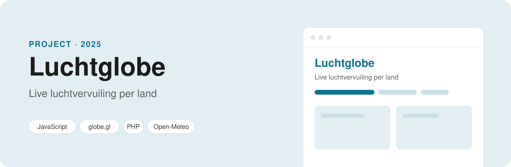

<p align="center">
  
</p>

<p align="center">
  
  
  
  
</p>

# Luchtglobe

Een 3D-wereldbol die laat zien hoe vervuild de lucht **nu** is in elk land. Elk land krijgt een kleur volgens de Europese luchtkwaliteitsklassen, van *Goed* tot *Extreem slecht*. De data ververst zichzelf elke 10 minuten.

**Live:** [parisangelopoulos.com/luchtglobe](https://parisangelopoulos.com/luchtglobe/)

## Functies

- **Draaibare wereldbol** (globe.gl, gebouwd op three.js) met 176 landen.
- **Vijf weergaven**: de Europese luchtkwaliteitsindex, fijnstof PM2.5 en PM10, stikstofdioxide en ozon.
- **Muis over een land**: alle waarden in één oogopslag.
- **Klik op een land** (of zoek het op): de index, een uitleg wat het betekent, en per stof een balk met de advieswaarde van de WHO.
- **Ranglijst**: de tien meest vervuilde en de vijf schoonste landen van dit moment, met pulserende ringen op de vijf slechtste.
- **Live-indicator** met de tijd van de meting en een aftelklok tot de volgende update.
- Werkt ook op een telefoon (de lijst schuift dan onder de wereldbol).

## Hoe het werkt

1. **De meetpunten**: `tools/build-data.js` koppelt de landsgrenzen (Natural Earth via `world-atlas`) aan de Nederlandse landnamen (`world-countries`) en aan de coördinaten van de hoofdstad (SimpleMaps via `world-cities-json`). Dat levert `data/countries.geojson` en `data/locations.json` op.
2. **De live data**: `api.php` vraagt voor alle hoofdsteden de actuele luchtkwaliteit op bij [Open-Meteo](https://open-meteo.com/en/docs/air-quality-api), in stukken van 50 plaatsen per verzoek. Die cijfers komen uit het model van [Copernicus (CAMS)](https://atmosphere.copernicus.eu/) en worden elk uur vernieuwd.
3. **De cache**: het antwoord blijft 10 minuten in `private/cache.json` staan, zodat alle bezoekers samen één verzoek doen. Een bestandsslot voorkomt dat twee bezoekers tegelijk gaan ophalen. Lukt het ophalen niet, dan toont de site de laatst bekende meting.
4. **De pagina**: `js/app.js` kleurt de landen, bouwt het paneel en vraagt op tijd nieuwe data op. Zonder PHP (als je de bestanden los opent) haalt de pagina de data rechtstreeks bij Open-Meteo.

## Zelf draaien

Je hebt alleen PHP nodig, geen database en geen API-sleutel.

```bash
git clone https://github.com/ParisAngelopoulos/luchtglobe.git
cd luchtglobe
php -S localhost:8000
```

Ga daarna naar http://localhost:8000. De landendata opnieuw bouwen kan met `npm install` en `npm run build:data`.

## Mappen

| Map / bestand | Wat erin staat |
| --- | --- |
| `index.html`, `css/`, `js/app.js` | De pagina, de opmaak en de wereldbol |
| `api.php` | Haalt de live data op en bewaart die 10 minuten |
| `data/` | Landsgrenzen en het meetpunt (hoofdstad) per land |
| `private/` | De cache (niet via het web te openen) |
| `vendor/globe.gl.min.js` | De wereldbol-bibliotheek (MIT) |
| `tools/build-data.js` | Bouwt de bestanden in `data/` |

## Bronnen

- Luchtkwaliteit: Open-Meteo, met data van Copernicus Atmosphere Monitoring Service (CAMS)
- Landsgrenzen: Natural Earth (publiek domein), via `world-atlas`
- Hoofdsteden: SimpleMaps World Cities Database (CC BY 4.0), via `world-cities-json`
- Wereldbol: [globe.gl](https://github.com/vasturiano/globe.gl) (MIT)

---

Gemaakt door **Paris Angelopoulos**, web developer in opleiding · [GitHub](https://github.com/ParisAngelopoulos) · [parisangelopoulos@gmail.com](mailto:parisangelopoulos@gmail.com)
